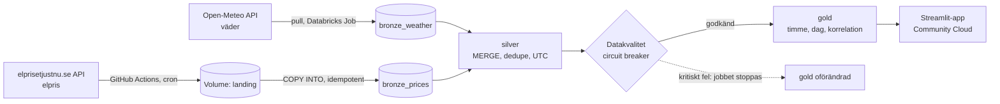

# Elpris & väder – Malvin Portfolio Project

**Live demo:** _(länk läggs till efter deploy)_

En live data pipeline i Databricks som var tredje timme hämtar **elpriser** och **väder** för Sveriges fyra elområden
(SE1–SE4), kvalitetskontrollerar datat och visar det i en publik Streamlit-app. Frågan appen svarar på:
*blåser det mycket, blir elen billigare, och när är nästa billiga timme?*

## Arkitektur



## Designbeslut

- **Två ingestmönster.** Väder hämtas direkt av Databricks (pull). Elpris-API:et är blockerat från Databricks Free Edition
  (jag testade utgående trafik till flera domäner), så ett schemalagt **GitHub Actions**-jobb hämtar priserna och
  laddar upp dem till en Unity Catalog-volym (push). `COPY INTO` läser bara in nya filer, så pipelinen är idempotent.
- **Medallion med MERGE.** Bronze är append-only med `_ingested_at`. Silver deduplicerar och upsertar (senast hämtade värdet
  vinner), så omkörningar och överlappande hämtningar ger samma resultat.
- **Circuit breaker.** Datakvalitetskontrollerna körs *före* gold. Kritiska fel (tomma tabeller, saknade elområden,
  dubbletter) stoppar jobbet så att appen behåller senaste kontrollerade data. Varningar (färskhet, orimliga värden) visas i appen.
- **Tidszoner.** All lagring i UTC; Open-Meteos lokala tider konverteras explicit från `Europe/Stockholm`.
- **Minsta möjliga rättigheter.** Den publika appen använder en egen service principal med enbart `SELECT` på gold-schemat.
  GitHub Actions använder en annan service principal som bara kan skriva till landing-volymen. Inga nycklar i koden.
- **Schemalagd drift.** Databricks Job var tredje timme, GitHub Actions 15 minuter innan.
- **Testat.** Extraktion och kvalitetslogik är ren Python med enhetstester, som körs i CI (`.github/workflows/ci.yml`).

## Struktur

| Sökväg | Innehåll |
|---|---|
| `databricks.yml`, `resources/job.yml` | Asset Bundle: scheman, volym och schemalagt jobb |
| `src/pipeline/` | Notebooks: 01 väder, 02 elpris, 03 silver, 04 kvalitet, 05 gold, samt `elvader_lib.py` |
| `extract/fetch_prices.py` | Hämtar elpriser och laddar upp till Databricks (körs av GitHub Actions) |
| `app/` | Streamlit-appen |
| `tests/` | Enhetstester |
| `.github/workflows/` | `extract_prices.yml` (cron) och `ci.yml` (tester) |

## Köra själv

```bash
databricks auth login --host https://<workspace>.cloud.databricks.com
databricks bundle deploy
databricks bundle run elvader_etl
pip install pytest && pytest
```

GitHub Actions kräver secrets `DATABRICKS_HOST`, `DATABRICKS_CLIENT_ID` och `DATABRICKS_CLIENT_SECRET`.
Starta första laddningen med *Actions → Hämta elpriser → Run workflow* och `days_back = 14`.
Appens secrets finns beskrivna i `app/.streamlit/secrets.toml.example`.

## Källor och begränsningar

- Elpriser: [elprisetjustnu.se](https://www.elprisetjustnu.se/elpris-api) (Nord Pool day-ahead). Väder: [Open-Meteo](https://open-meteo.com/) (modelldata, inte mätstationer).
- Ett referensväder per elområde (Luleå, Östersund, Stockholm, Malmö) är en förenkling.
- Körs på Databricks Free Edition med kvoter; appen och warehouse kan behöva några sekunder för att vakna.
